<div align="center">

# Pipeline CI/CD sécurisé

**Du `git push` à la production : testé, analysé, empaqueté et déployé automatiquement sur Azure.**

[](https://github.com/Ayoub-BD/projet-devops/actions/workflows/ci.yml)


</div>

Chaîne de livraison continue d'une application Flask conteneurisée, de l'infrastructure cloud jusqu'au déploiement :

- **Infrastructure as Code** : réseau, pare-feu et machine virtuelle Azure décrits avec Terraform
- **Configuration serveur** : installation de Docker et durcissement du système avec Ansible
- **CI/CD** : tests, analyse de sécurité, build, publication et déploiement avec GitHub Actions

L'application est volontairement minimale (une route HTTP). Le périmètre du projet est l'industrialisation qui l'entoure : chaque `push` sur `main` est testé, analysé, empaqueté puis déployé sans intervention manuelle.

<details>
<summary><b>Sommaire</b></summary>

- [Architecture](#architecture)
- [Pipeline CI/CD](#pipeline-cicd)
- [Infrastructure Azure](#infrastructure-azure)
- [Configuration du serveur](#configuration-du-serveur)
- [Sécurité](#sécurité)
- [Preuves de fonctionnement](#preuves-de-fonctionnement)
- [Stack technique](#stack-technique)
- [Structure du dépôt](#structure-du-dépôt)
- [Prise en main](#prise-en-main)
- [Défis rencontrés](#défis-rencontrés)
- [Évolutions envisagées](#évolutions-envisagées)
- [Auteur](#auteur)

</details>

---

## Architecture

<p align="center">
  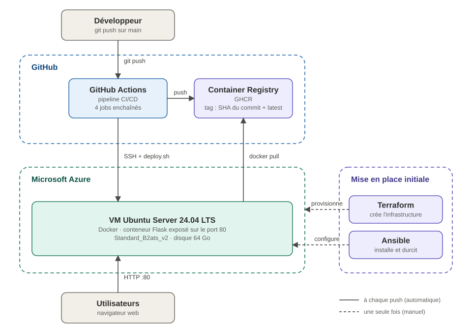
</p>

| Couche | Outil | Responsabilité |
|---|---|---|
| Infrastructure | Terraform | Crée les ressources Azure de manière reproductible |
| Configuration | Ansible | Installe Docker, configure le pare-feu, SSH et fail2ban |
| Livraison | GitHub Actions | Teste, analyse, construit, publie et déploie l'application |
| Exécution | Docker | Isole l'application et fige son environnement |

---

## Pipeline CI/CD

Défini dans [`.github/workflows/ci.yml`](.github/workflows/ci.yml), déclenché à chaque push sur `main`. Les jobs sont chaînés par dépendances : un échec à une étape empêche toutes les suivantes.

<p align="center">
  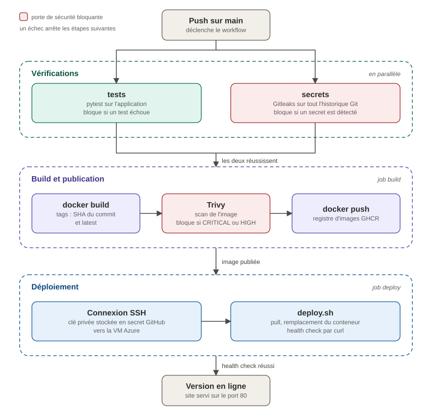
</p>

| Job | Dépend de | Actions | Bloque si |
|---|---|---|---|
| `tests` | | Installe les dépendances, exécute `pytest` | Un test échoue |
| `secrets` | | Analyse **tout l'historique Git** avec Gitleaks | Un secret est détecté |
| `build` | `tests`, `secrets` | Construit l'image, la scanne avec Trivy, la publie sur GHCR | Faille `CRITICAL` ou `HIGH` corrigeable |
| `deploy` | `build` | Se connecte en SSH, exécute `scripts/deploy.sh` avec l'image du commit | Le site ne répond pas après déploiement |

### Déploiement sur le serveur

Le script [`scripts/deploy.sh`](scripts/deploy.sh) s'exécute sur la VM avec `set -euo pipefail` :

1. `docker pull` de l'image taguée avec le SHA du commit
2. Suppression de l'ancien conteneur, lancement du nouveau (`80 → 5000`, `--restart unless-stopped`)
3. Health check : `curl` sur `localhost`, le script échoue si le site ne répond pas
4. Nettoyage des anciennes images (`docker image prune`)

Chaque version déployée est identifiable par son commit grâce au tag SHA, ce qui permet de revenir à une version précédente.

---

## Infrastructure Azure

Provisionnée par [`terraform/`](terraform/) (provider `azurerm ~> 4.0`).

<p align="center">
  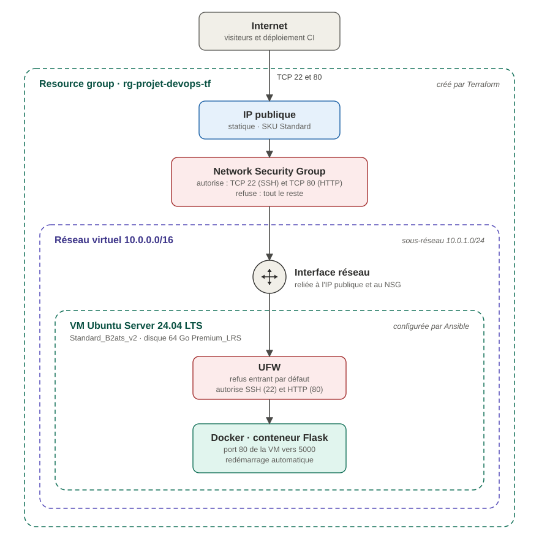
</p>

| Ressource | Rôle |
|---|---|
| `azurerm_resource_group` | Regroupe toutes les ressources |
| `azurerm_virtual_network`, `azurerm_subnet` | Réseau privé et sous-réseau |
| `azurerm_public_ip` | Adresse IP fixe |
| `azurerm_network_security_group` | Pare-feu cloud : ports 22 et 80 ouverts |
| `azurerm_network_interface` | Relie la VM au sous-réseau, à l'IP et au NSG |
| `azurerm_linux_virtual_machine` | Serveur Ubuntu 24.04 LTS, accès par clé SSH uniquement |

Région, taille de VM et abonnement sont paramétrables dans [`variables.tf`](terraform/variables.tf). L'IP publique est exposée en sortie ([`outputs.tf`](terraform/outputs.tf)).

<details>
<summary>Sortie de <code>terraform apply</code></summary>

```text
azurerm_resource_group.rg: Creation complete after 23s
azurerm_public_ip.ip: Creation complete after 3s
azurerm_network_security_group.nsg: Creation complete after 3s
azurerm_virtual_network.vnet: Creation complete after 5s
azurerm_subnet.subnet: Creation complete after 5s
azurerm_network_interface.nic: Creation complete after 2s
azurerm_network_interface_security_group_association.nic_nsg: Creation complete after 2s
azurerm_linux_virtual_machine.vm: Creation complete after 49s

Apply complete! Resources: 8 added, 0 changed, 0 destroyed.

Outputs:

ip_publique = "x.x.x.x"
```

Terraform déduit l'ordre de création des références entre ressources : le groupe de ressources d'abord, puis le réseau, l'IP et le NSG en parallèle, et la VM en dernier.

</details>

---

## Configuration du serveur

Le playbook [`ansible/playbook.yml`](ansible/playbook.yml) est idempotent : il peut être rejoué sans effet de bord.

| Domaine | Mise en œuvre |
|---|---|
| Docker | Dépôt officiel avec vérification de la clé GPG, installation de Docker Engine, activation au démarrage |
| Pare-feu | UFW : SSH (22) et HTTP (80) autorisés, tout autre trafic entrant refusé |
| SSH | Authentification par mot de passe désactivée, connexion root interdite, configuration validée par `sshd -t` avant redémarrage du service |
| Anti brute-force | fail2ban sur `sshd` : bannissement d'1 heure après 5 échecs |

---

## Sécurité

| Couche | Mesure | Emplacement |
|---|---|---|
| Code | Détection de secrets sur tout l'historique Git | `ci.yml`, job `secrets` |
| Image | Scan Trivy, build bloqué si faille critique ou haute corrigeable | `ci.yml`, job `build` |
| Image | Base `python:3.14-slim`, `pip` désinstallé de l'image finale, `.dockerignore` | `Dockerfile` |
| Réseau | NSG Azure : seuls les ports 22 et 80 sont ouverts | `terraform/main.tf` |
| Réseau | UFW : refus entrant par défaut | `ansible/playbook.yml` |
| Accès | Clé SSH obligatoire, mot de passe et root désactivés | `ansible/playbook.yml` |
| Accès | fail2ban contre le brute-force SSH | `ansible/playbook.yml` |
| Secrets CI | Clé privée SSH dédiée à la CI, hôte et utilisateur stockés dans les GitHub Secrets | `ci.yml` |

---

## Preuves de fonctionnement

### Le pipeline bloque ce qui ne doit pas partir en production

| Pipeline complet réussi | Test en échec : build et déploiement bloqués |
|---|---|
| 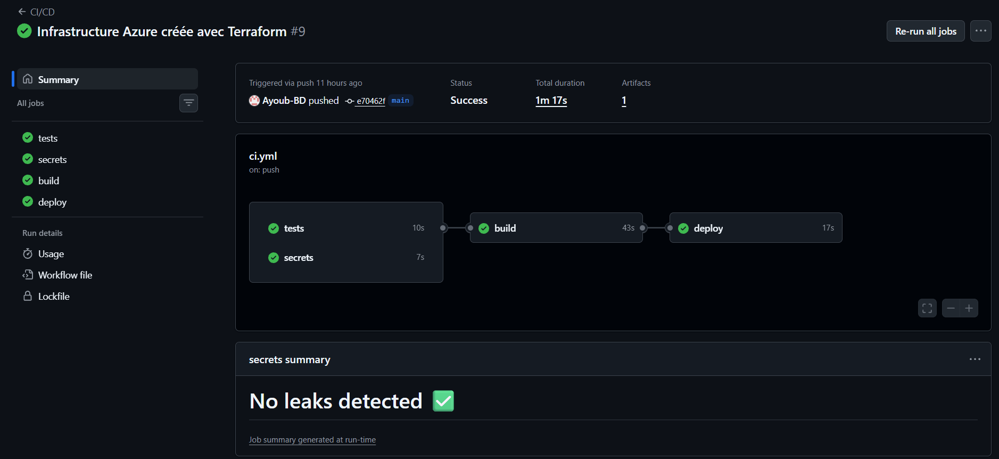 | 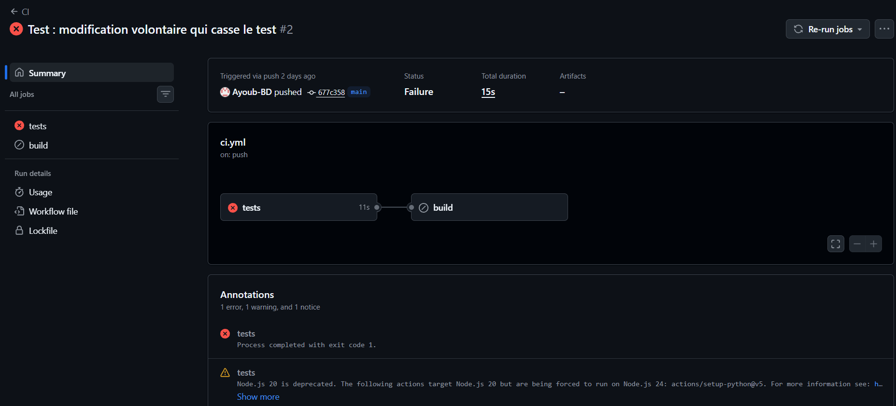 |

<details>
<summary><b>Sécurité : Trivy et Gitleaks</b></summary>

<br>

**Trivy** a détecté 4 failles `HIGH` dans des bibliothèques embarquées par `pip`. Retirer `pip` de l'image finale les a toutes supprimées.

| Avant | Après |
|---|---|
| 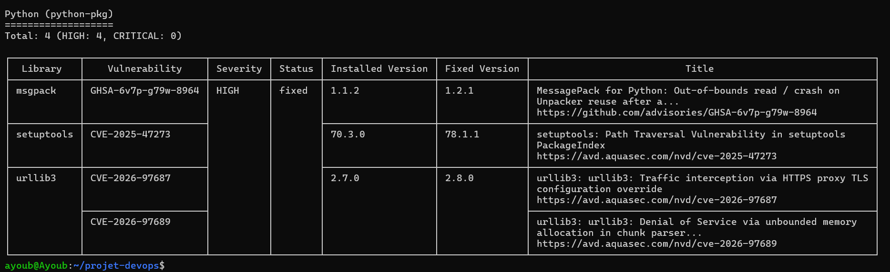 | 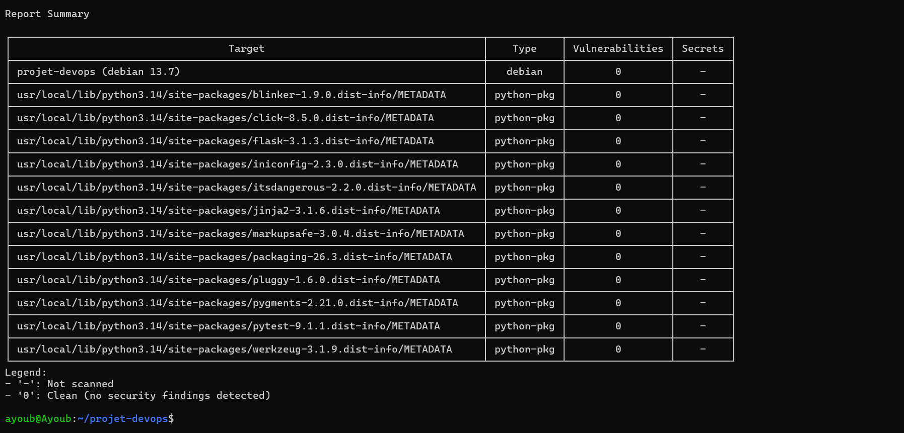 |

**Gitleaks**, testé avec de faux secrets : le token GitHub et la clé AWS sont détectés.

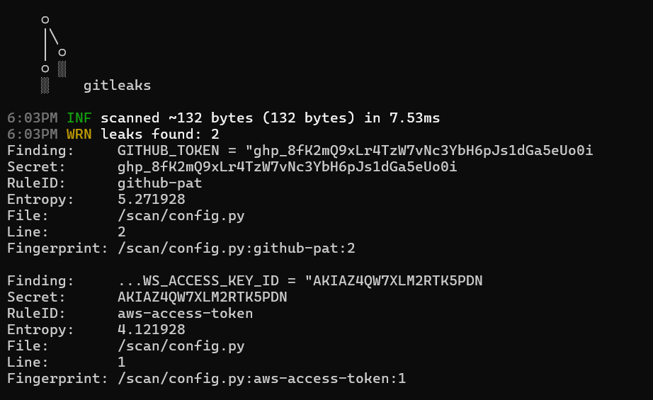

</details>

<details>
<summary><b>Infrastructure et déploiement</b></summary>

<br>

**Ansible idempotent** : une deuxième exécution ne modifie rien (`changed=0`).

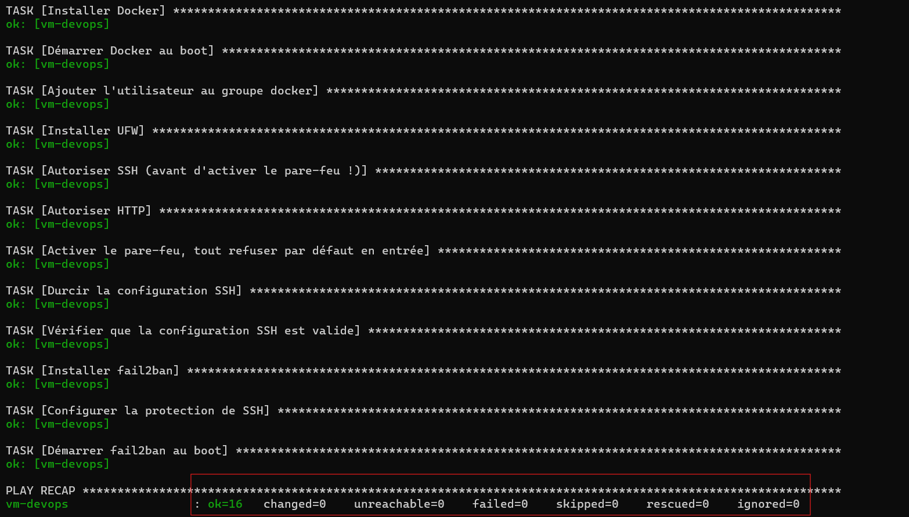

**Images publiées sur GHCR**, une par commit déployé, plus le tag `latest`.

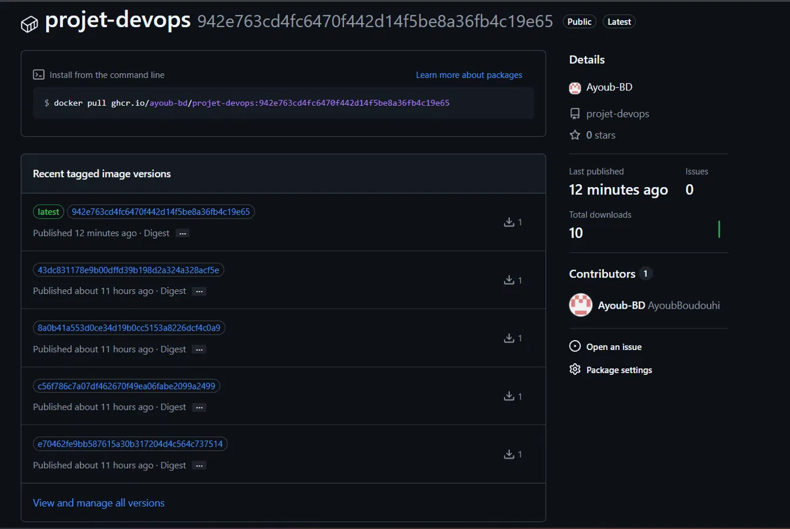

**Application déployée automatiquement** après un simple `git push`.

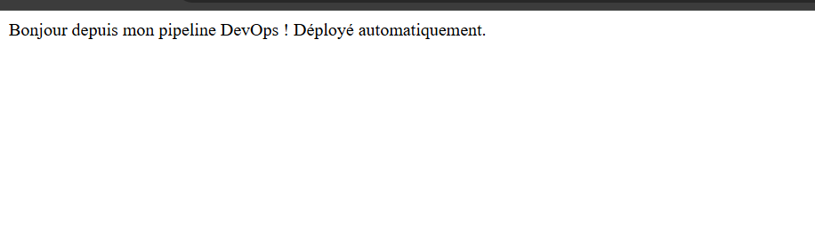

</details>

---

## Stack technique

| Domaine | Technologies |
|---|---|
| Application | Python 3.14, Flask 3, pytest |
| Conteneurs | Docker, GitHub Container Registry |
| CI/CD | GitHub Actions |
| Infrastructure as Code | Terraform |
| Configuration | Ansible |
| Cloud | Microsoft Azure |
| Sécurité | Gitleaks, Trivy, UFW, fail2ban |
| Système | Ubuntu Server 24.04 LTS, Bash |

---

## Structure du dépôt

```
.
├── app.py                      Application Flask
├── test_app.py                 Tests pytest
├── Dockerfile                  Image de l'application
├── .dockerignore               Fichiers exclus de l'image
├── requirements.txt            Dépendances Python
├── .github/workflows/ci.yml    Pipeline CI/CD
├── terraform/                  Infrastructure Azure
│   ├── main.tf
│   ├── variables.tf
│   ├── outputs.tf
│   └── .terraform.lock.hcl     Version figée du provider
├── ansible/                    Configuration et durcissement du serveur
│   ├── playbook.yml
│   └── inventory.ini
├── scripts/deploy.sh           Script de déploiement exécuté sur la VM
└── docs/
    ├── *.svg                   Schémas d'architecture
    └── captures/               Captures d'écran
```

---

## Prise en main

### Exécution locale

```bash
python -m venv .venv && source .venv/bin/activate
pip install -r requirements.txt
pytest
flask run          # http://localhost:5000
```

### Avec Docker

```bash
docker build -t projet-devops .
docker run --rm -p 8080:5000 projet-devops   # http://localhost:8080
```

### Provisionner l'infrastructure

Prérequis : abonnement Azure (`az login`), Terraform, Ansible (collection `community.general`), et deux paires de clés SSH : `~/.ssh/azure_devops` (administration) et `~/.ssh/github_deploy` (déploiement depuis la CI).

```bash
# 1. Créer l'infrastructure
cd terraform
terraform init
terraform apply -var="subscription_id=<ID_ABONNEMENT>"     # relever la sortie ip_publique

# 2. Configurer le serveur (renseigner l'IP dans ansible/inventory.ini)
cd ../ansible
ansible-playbook -i inventory.ini playbook.yml
```

> [!NOTE]
> Le fichier d'état `terraform.tfstate` et les variables locales `terraform.tfvars` sont exclus du dépôt par le `.gitignore`.

### Activer le déploiement continu

Ajouter ces secrets dans *Settings > Secrets and variables > Actions* :

| Secret | Contenu |
|---|---|
| `SSH_PRIVATE_KEY` | Clé privée de déploiement |
| `SSH_HOST` | Adresse IP du serveur |
| `SSH_USER` | Utilisateur SSH |

Chaque push sur `main` déclenche ensuite le pipeline complet.

---

## Défis rencontrés
 
| Problème | Solution |
|---|---|
| Trivy bloquait le build : 4 failles `HIGH` dans des bibliothèques embarquées par `pip` | `pip` n'est utile qu'à la construction : il est désinstallé de l'image finale |
| Le fichier d'état Terraform (`terraform.tfstate`), qui décrit toute l'infrastructure, avait été versionné | Retiré du dépôt et ajouté au `.gitignore`, avec les variables locales |
| L'image lançait le serveur de développement de Flask, en `root` | Passage à Gunicorn, exécuté par un utilisateur sans privilèges |
 
---

## Évolutions envisagées

- **Sécuriser les échanges** : passer le site en HTTPS pour chiffrer les connexions
- **Surveiller l'application** : être alerté automatiquement si le site tombe ou si le serveur est surchargé (Prometheus et Grafana)
- **Revenir en arrière automatiquement** : relancer la version précédente si une mise en production échoue
- **Limiter les accès** : n'autoriser la connexion d'administration au serveur que depuis des adresses connues

---

## Auteur

**Ayoub Boudouhi**, élève ingénieur en Réseaux, Systèmes & Télécoms (UPSSITECH, Toulouse)
